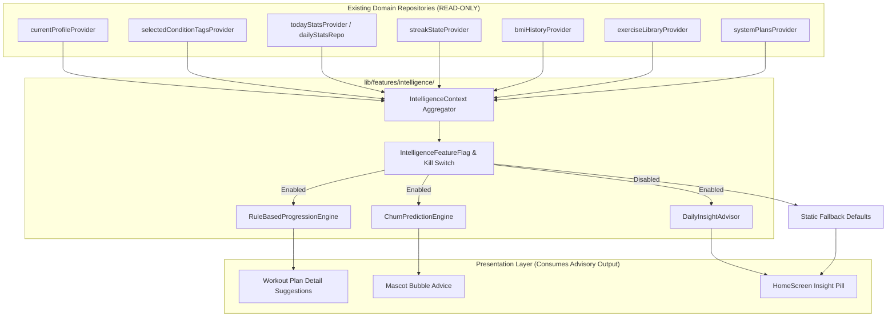
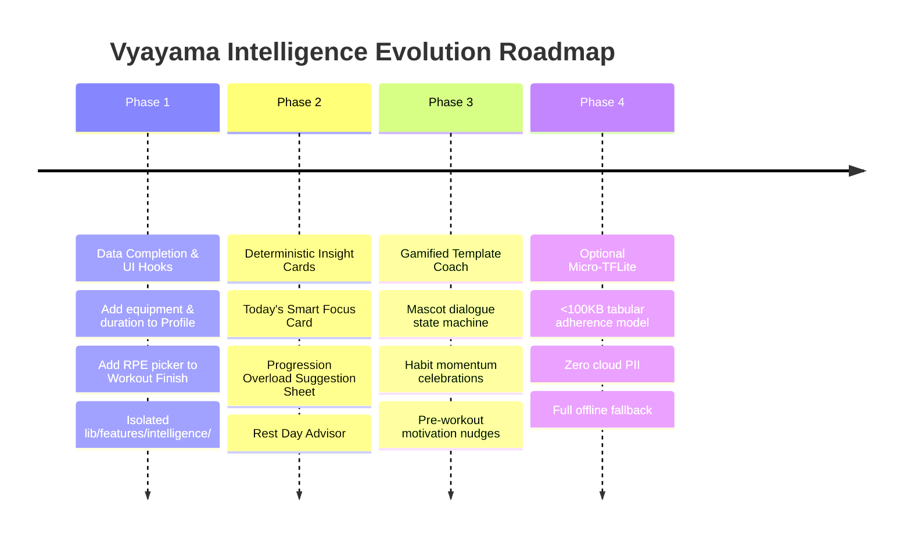

# Comprehensive Phase 0 Intelligence Architecture & Readiness Audit: Vyayama

**Document Version:** 1.0.0  
**Audit Date:** October 26, 2026  
**Auditor:** Antigravity AI Systems & Architecture Team  
**Scope:** Architecture, Data Readiness, Privacy, Safety, and Feasibility Audit for Intelligence Features (Adaptive Plans, Insights, Recommendations, and On-Device Coaching)  
**Operating Rules:** Strictly READ-ONLY across all existing application code, database migrations, and configurations. Zero third-party paid AI APIs added.  

---

## Executive Summary & Regression Baseline

Prior to conducting this audit, the entire codebase was analyzed for static health and test suite integrity to establish an immutable regression baseline.

### Pre-Flight Regression Verification
- **Static Analysis (`flutter analyze`):**
  ```text
  Analyzing FitBuddy...
  No issues found! (ran in 62.7s)
  ```
  Result: **0 issues found** `[VERIFIED BY TEST]`.
- **Test Suite (`flutter test`):**
  ```text
  00:37 +566: All tests passed!
  ```
  Result: **566 / 566 tests passed (100%)** `[VERIFIED BY TEST]`.

### Evidence Standards Applied Across All Findings
Every assertion, schema finding, and algorithmic characteristic is strictly classified under one of three evidence standards:
- `[VERIFIED BY TEST]`: Confirmed by passing automated unit, widget, or integration test suites in `test/`.
- `[CODE READING ONLY]`: Discovered via direct source code inspection with exact file paths and line numbers.
- `[NEEDS REAL DEVICE]`: Physical hardware, low-power sensor coprocessor, or OEM battery manager behavior that requires physical execution on a test device.

---

## Part 1: What Already Exists (Do Not Duplicate It)

The Vyayama repository already contains mature, deterministic, offline-first logic engines for workout planning, safety adaptation, progression modeling, habit adherence, and gamification. Any new intelligence layer must build *on top* of these systems rather than duplicating or replacing them.

| System / Engine | Source File & Lines | Inputs | Outputs | Deterministic vs Probabilistic | Test Status | Offline Capability |
|---|---|---|---|---|---|---|
| **1. WorkoutRecommendationEngine** | [`lib/features/workouts/logic/recommendation_engine.dart:95-312`](file:///e:/FitBuddy/lib/features/workouts/logic/recommendation_engine.dart#L95-L312) | `UserFitnessContext` (goal, level, conditionTags, availableEquipment, preferredDaysPerWeek, age, bmi), `Iterable<WorkoutPlan>`, `List<Exercise>` | `List<PlanRecommendation>` (ranked by `RecommendationScore` 0–100, explainability strings, adaptation notes) | **Deterministic** (weighted scoring: 35% goal, 25% level, 20% safety, 10% equipment, 10% schedule) | `[VERIFIED BY TEST]` (`test/workouts/recommendation_engine_test.dart`) | **100% Offline** (Pure Dart, zero external dependencies) |
| **2. PlanAdapter** | [`lib/features/workouts/logic/plan_adapter.dart:52-135`](file:///e:/FitBuddy/lib/features/workouts/logic/plan_adapter.dart#L52-L135) | `WorkoutPlan`, `List<String> conditionTags`, `List<Exercise> exerciseLibrary` | `AdaptationResult` (`WorkoutPlan` sanitized with unsafe exercises replaced or removed, `List<AdaptationNote>`) | **Deterministic** (priority: same muscle group + safe + unused in day + same equipment + nearest MET) | `[VERIFIED BY TEST]` (`test/workouts/plan_adapter_test.dart`: 7 passing tests) | **100% Offline** (In-memory pure Dart) |
| **3. Exercise Contraindication Filtering** | [`lib/features/workouts/data/exercise.dart:73-89, 231-245`](file:///e:/FitBuddy/lib/features/workouts/data/exercise.dart#L73-L89), [`assets/data/conditions.json`](file:///e:/FitBuddy/assets/data/conditions.json) | Exercise tags (`contraindications`), User tags (`selectedConditionTagsProvider`) | `conflictsWith() -> Set<String>`, `isSafeFor() -> bool` | **Deterministic** (case-insensitive substring and tag containment) | `[VERIFIED BY TEST]` (`test/workouts/workout_flow_qa_test.dart`) | **100% Offline** (Bundled asset JSON and memory sets) |
| **4. Progression Model (Double Progression)** | [`lib/features/workouts/logic/progression_model_interface.dart:56-126`](file:///e:/FitBuddy/lib/features/workouts/logic/progression_model_interface.dart#L56-L126) | `ProgressionInput` (`currentLoadKg`, `targetRepsMin`, `targetRepsMax`, `completedRepsPerSet`, `reportedRpe`) | `ProgressionRecommendation` (`action`: increaseLoad / increaseReps / maintain / regressOrDeload, `nextLoadKg`, `nextTargetReps`, `rationale`) | **Deterministic** (Standard sports-science double progression: +5% or 2.5kg when all sets hit max reps with RPE <= 8.5) | `[VERIFIED BY TEST]` (`test/workouts/recommendation_engine_test.dart`) | **100% Offline** (Pure Dart calculation) |
| **5. Adherence & Churn Prediction Model** | [`lib/features/workouts/logic/adherence_model_interface.dart:99-144`](file:///e:/FitBuddy/lib/features/workouts/logic/adherence_model_interface.dart#L99-L144) | `AdherenceFeatures` (`trailing7DayAdherence`, `currentStreakDays`, `daysSinceLastWorkout`, `averageReportedRpe`, `skippedExercisesRatio`, `preferredWorkoutHour`) | `AdherencePrediction` (`churnRiskProbability` 0.0–1.0, `recommendedIntensityAdjustment` -0.15 to +0.05, `motivationalIntervention`, `explanation`) | **Deterministic** (Rule-based heuristics classifying overtraining, momentum, and inactivity) | `[VERIFIED BY TEST]` (`test/workouts/recommendation_engine_test.dart`) | **100% Offline** (Pure Dart implementation of `IAdherenceModel`) |
| **6. Streak & Challenge Logic** | [`lib/features/challenges/streak_logic.dart:30-125`](file:///e:/FitBuddy/lib/features/challenges/streak_logic.dart#L30-L125), [`lib/features/challenges/daily_challenge_picker.dart:7-22`](file:///e:/FitBuddy/lib/features/challenges/daily_challenge_picker.dart#L7-L22) | `StreakState`, activity completion timestamp, epoch day, challenge catalog | `StreakUpdate` (`state`, `streakChanged`, `xpAwarded`, `milestone`), deterministic daily `Challenge` | **Deterministic** (Milestone thresholds: 3, 7, 14, 30, 50, 100 days; modulus epoch day picker) | `[VERIFIED BY TEST]` (`test/challenges/streak_logic_test.dart`) | **100% Offline** (Calendar-math resilient against DST and offline days) |
| **7. Step Tracking & Daily Stats** | [`android/app/src/main/kotlin/com/vyayama/fitbuddy/StepSensorManager.kt:101-190`](file:///e:/FitBuddy/android/app/src/main/kotlin/com/vyayama/fitbuddy/StepSensorManager.kt#L101-L190), [`lib/core/services/step_tracking_service.dart:67-160`](file:///e:/FitBuddy/lib/core/services/step_tracking_service.dart#L67-L160) | Hardware pedometer sensor (`Sensor.TYPE_STEP_COUNTER`), system boot ticks, date change | `todaySteps`, `DailyStats` (steps, calories, activeMinutes) written to `LocalDailyStatsStorage` | **Deterministic** (Incremental sensor hardware FIFO deltas) | `[VERIFIED BY TEST]` (`test/qa/offline_online_sync_test.dart`) | **100% Offline** (Reads on-device silicon coprocessor, buffers in SQLite/Prefs) |
| **8. Health Profile & Medical Filters** | [`lib/features/health_profile/data/supabase_health_repository.dart:80-242`](file:///e:/FitBuddy/lib/features/health_profile/data/supabase_health_repository.dart#L80-L242), [`lib/features/health_profile/providers.dart:80-166`](file:///e:/FitBuddy/lib/features/health_profile/providers.dart#L80-L166) | User conditions checklist, medicine schedules, meal reminder timings | `selectedConditionTagsProvider`, active alarms scheduled via `NotificationService` | **Deterministic** (Key-value set mappings and scheduled local notifications) | `[VERIFIED BY TEST]` (`test/qa/offline_online_sync_test.dart`) | **100% Offline** (Persists in `SharedPreferences`, background sync to Supabase) |
| **9. Schedule & Reminders Engine** | [`lib/core/services/notification_service.dart:550-650`](file:///e:/FitBuddy/lib/core/services/notification_service.dart#L550-L650), [`lib/core/services/reminder_reconciliation_service.dart:58-197`](file:///e:/FitBuddy/lib/core/services/reminder_reconciliation_service.dart#L58-L197) | Target reminder time, alarm permissions, system boot receiver intents | Exact Android AlarmManager intents (`AndroidScheduleMode.alarmClock` / `inexactAllowWhileIdle`) | **Deterministic** (Direct platform channel calls to OS AlarmManager) | `[VERIFIED BY TEST]` (`test/services/reminder_reconciliation_test.dart`) | **100% Offline** (Local notification triggers require zero cloud communication) |
| **10. Water & Nutrition Logic** | [`lib/features/nutrition/domain/nutrition_calculator.dart:144-252`](file:///e:/FitBuddy/lib/features/nutrition/domain/nutrition_calculator.dart#L144-L252) | `NutritionSex`, `weightKg`, `heightCm`, `age`, `ActivityLevel`, `NutritionGoal` | `CalorieEstimate` (BMR, TDEE, targetKcal, safe floors), `MacroSplit`, `dailyWaterGlasses` (clamped 6–12) | **Deterministic** (Mifflin-St Jeor formula, 1200/1500 kcal floors, under-18 weight-loss ban) | `[VERIFIED BY TEST]` (`test/nutrition/nutrition_calculator_test.dart`) | **100% Offline** (Pure mathematical model) |
| **11. Mascot Mood Engine** | [`lib/features/mascot/mood_engine.dart:1-112`](file:///e:/FitBuddy/lib/features/mascot/mood_engine.dart#L1-L112) | `MoodInputs` (`now`, `workoutDoneToday`, `missedBlockNow`, `daysSkippedInARow`, `streakMilestoneHit`, `challengeJustCompleted`, `snapStreakAtRisk`, sleep window) | `MascotMood` (`celebrating`, `proud`, `angry`, `worried`, `sad`, `sleepy`, `happy`) | **Deterministic** (Strict priority tier hierarchy, zero random fluctuation) | `[VERIFIED BY TEST]` (`test/mascot/mood_engine_test.dart`: 204 lines of tests) | **100% Offline** (Pure Dart state evaluation) |
| **12. Workout Log Repositories** | [`lib/features/workouts/data/supabase_workout_log_repository.dart:18-85`](file:///e:/FitBuddy/lib/features/workouts/data/supabase_workout_log_repository.dart#L18-L85), [`lib/features/workouts/data/workout_log.dart:1-42`](file:///e:/FitBuddy/lib/features/workouts/data/workout_log.dart#L1-L42) | Completed session payload (`planDayId`, `durationMin`, `caloriesBurned`, `completedAt`) | `WorkoutLog` saved to disk cache / Supabase `workout_logs` table | **Deterministic** (Database insert / local file outbox write) | `[VERIFIED BY TEST]` (`test/workouts/offline_workout_log_persistence_test.dart`) | **100% Offline** (Writes to local disk outbox on network failure) |

---

## Part 2: Data Inventory for User-Facing Facts

To provide intelligent feedback, an AI system must know what user facts are recorded, where they reside, how long they are kept, and where critical gaps exist.

### Current Data Inventory Matrix

| Data Entity | Primary Storage | Local Offline Cache | Schema / Key Fields | History Depth | Available to Reasoning Engine? | Evidence Tag & Citation |
|---|---|---|---|---|---|---|
| **User Profile** | Supabase table `profiles` | `SharedPreferences` (`cached_profile_$userId`) | `id`, `name`, `age`, `gender`, `weight_kg`, `height_cm`, `goal`, `fitness_level`, `wake_time`, `sleep_time`, `work_start`, `work_end`, `username`, `avatar_url`, `timezone`, `onboarding_completed` | Single current row (latest snapshot) | **Yes** via `currentProfileProvider` | `[CODE READING ONLY]` ([profile.dart:21-40](file:///e:/FitBuddy/lib/features/profile/data/profile.dart#L21-L40)) |
| **Health Conditions** | Supabase table `user_conditions` | `SharedPreferences` (`vyayama_health_selected_conditions`) | `user_id`, `condition_key`, `created_at` | Current selected set | **Yes** via `selectedConditionTagsProvider` | `[VERIFIED BY TEST]` ([supabase_health_repository.dart:80-92](file:///e:/FitBuddy/lib/features/health_profile/data/supabase_health_repository.dart#L80-L92)) |
| **Prescribed Medicines** | Supabase table `user_medicines` | `SharedPreferences` (`vyayama_health_medicines_list`) | `id`, `user_id`, `name`, `dosage`, `time_minutes`, `sound`, `vibrate`, `enabled`, `is_dirty` | Active configured list | **Yes** via `medicinesProvider` | `[VERIFIED BY TEST]` ([supabase_health_repository.dart:138-180](file:///e:/FitBuddy/lib/features/health_profile/data/supabase_health_repository.dart#L138-L180)) |
| **Daily Step & Activity Stats** | Supabase table `daily_stats` | SQLite & `SharedPreferences` (`LocalDailyStatsStorage`) | `id`, `user_id`, `date` (`YYYY-MM-DD`), `steps`, `calories`, `active_minutes` | Unlimited historical days | **Yes** via `dailyStatsRepositoryProvider` / `todayStatsProvider` | `[VERIFIED BY TEST]` ([daily_stats.dart:6-31](file:///e:/FitBuddy/lib/features/dashboard/data/daily_stats.dart#L6-L31)) |
| **Workout Logs** | Supabase table `workout_logs` | Local file outbox (`local_workout_logs.json`) | `id`, `user_id`, `plan_day_id`, `completed_at`, `duration_min`, `calories_burned` | Historical records | **Partial** (Only aggregate session stats; exercise details not saved) | `[CODE READING ONLY]` ([workout_log.dart:5-24](file:///e:/FitBuddy/lib/features/workouts/data/workout_log.dart#L5-L24)) |
| **BMI & Weight History** | Supabase table `bmi_records` | `SharedPreferences` (`local_bmi_history_$userId`) | `id`, `user_id`, `weight_kg`, `height_cm`, `bmi`, `recorded_at`, `notes` | Unlimited historical entries | **Yes** via `bmiHistoryProvider` | `[CODE READING ONLY]` ([014_bmi_records.sql:3-12](file:///e:/FitBuddy/supabase/migrations/014_bmi_records.sql#L3-L12), [bmi_history_repository.dart:27-70](file:///e:/FitBuddy/lib/features/profile/data/bmi_history_repository.dart#L27-L70)) |
| **Daily Challenges & Streaks** | Supabase table `user_challenges`, `user_streaks` | `SharedPreferences` (`streak_state_v1`) | `current`, `longest`, `last_active_date`, `xp`, `milestones_claimed` | Unlimited consecutive days | **Yes** via `streakStateProvider` | `[VERIFIED BY TEST]` ([streak_state.dart:1-35](file:///e:/FitBuddy/lib/features/challenges/data/streak_state.dart#L1-L35)) |
| **Water Logging** | Local only (`SharedPreferences`) | `SharedPreferences` (`water_log_date`, `water_glasses_date`) | `date`, `glasses_count` | 1 day (today only) | **Yes** via `waterLogProvider` | `[CODE READING ONLY]` ([providers.dart:11-45](file:///e:/FitBuddy/lib/features/nutrition/providers.dart#L11-L45)) |
| **Daily Schedule Blocks** | Supabase table `schedule_blocks` | `SharedPreferences` (`cached_schedule_$uid`) | `id`, `user_id`, `title`, `type` (`sleep`/`work`/`workout`/`meal`), `start_minutes`, `end_minutes`, `days_of_week` | Current weekly recurring schedule | **Yes** via `scheduleRepositoryProvider` | `[CODE READING ONLY]` ([schedule_repository.dart](file:///e:/FitBuddy/lib/features/schedule/data/schedule_repository.dart)) |

---

### Critical Data Gaps Analysis

The prompt specifically mandates auditing five critical data points:

1. **Available Equipment:**
   - **Finding:** **NOT STORED in User Profile.**
   - **Evidence:** `Exercise.equipment` exists on exercises ([exercise.dart:49](file:///e:/FitBuddy/lib/features/workouts/data/exercise.dart#L49)), and `UserFitnessContext` accepts `availableEquipment` defaulting to `['none', 'dumbbells']` ([recommendation_engine.dart:15](file:///e:/FitBuddy/lib/features/workouts/logic/recommendation_engine.dart#L15)). However, the `Profile` model ([profile.dart:21-40](file:///e:/FitBuddy/lib/features/profile/data/profile.dart#L21-L40)) and the database `profiles` table contain **no equipment field**. In `providers.dart:126-131`, `UserFitnessContext` is instantiated with no equipment arguments, forcing all users into the hardcoded fallback `['none', 'dumbbells']` `[CODE READING ONLY]`.
   - **Impact on Intelligence:** Recommending barbell, pull-up bar, or gym machine exercises will hallucinate user ownership unless the user explicitly owns them.

2. **Daily Time Available (Workout Duration Budget):**
   - **Finding:** **NOT CAPTURED.**
   - **Evidence:** Users set general `workStart`, `workEnd`, `wakeTime`, and `sleepTime` in `Profile`, but there is **no profile setting or onboarding question for "How much time do you want to spend working out each day?"** (e.g. 15m, 30m, 45m, 60m) `[CODE READING ONLY]`.
   - **Impact on Intelligence:** Cannot tailor high-intensity interval training vs lengthy 6-exercise strength routines to user availability.

3. **Preferred Workout Time:**
   - **Finding:** **NOT EXPLICITLY STORED AS A PREFERENCE.**
   - **Evidence:** `AdherenceFeatures` contains a field `preferredWorkoutHour` ([adherence_model_interface.dart:36](file:///e:/FitBuddy/lib/features/workouts/logic/adherence_model_interface.dart#L36)), but it is only computed post-hoc from previous session timestamps. There is no user-configured preference for morning, afternoon, or evening training `[CODE READING ONLY]`.
   - **Impact on Intelligence:** Nudges and reminders cannot proactively anticipate the user's intended workout window.

4. **Per-Workout Difficulty Rating & Exertion:**
   - **Finding:** **NOT CAPTURED IN WORKOUT LOGS.**
   - **Evidence:** `DoubleProgressionModel` and `RuleBasedAdherenceModel` accept `reportedRpe` (`1.0 - 10.0`) in their input contracts ([progression_model_interface.dart:19](file:///e:/FitBuddy/lib/features/workouts/logic/progression_model_interface.dart#L19)), but the `WorkoutLog` model ([workout_log.dart:6-31](file:///e:/FitBuddy/lib/features/workouts/data/workout_log.dart#L6-L31)) and the database table `workout_logs` **only store `duration_min` and `calories_burned`**. The workout completion screen never prompts the user for RPE or subjective difficulty ("Too easy", "Just right", "Too hard") `[CODE READING ONLY]`.
   - **Impact on Intelligence:** Progression and deload models cannot trigger without subjective fatigue metrics from the user.

5. **Weight History Over Time:**
   - **Finding:** **ALREADY CAPTURED AND IMPLEMENTED.**
   - **Evidence:** In Supabase migration `014_bmi_records.sql:3-12`, table `public.bmi_records` stores `weight_kg`, `height_cm`, `bmi`, `recorded_at`, and `notes`. This is mirrored offline in `BmiHistoryRepository` ([bmi_history_repository.dart:24-70](file:///e:/FitBuddy/lib/features/profile/data/bmi_history_repository.dart#L24-L70)) via `SharedPreferences` key `local_bmi_history_$userId` and exposed via `bmiHistoryProvider` in `lib/features/profile/profile_providers.dart:177`. Full historical progression is retained indefinitely `[CODE READING ONLY]`.
   - **Impact on Intelligence:** Fully available for weight trend smoothing, moving averages, and calorie adjustments.

---

## Part 3: Known Data-Quality Problems

Reviewing `docs/QA_REPORT.md` highlights 4 primary bugs and architectural constraints that directly affect intelligence feature reliability:

| Bug Reference | Summary of Issue | Severity | Status in Codebase | Direct Impact on Intelligence Features | Mitigation / Architectural Guardrail |
|---|---|---|---|---|---|
| **BUG-01** | **Meal & Bedtime Reminders Arriving Late** ([QA_REPORT.md:259](file:///e:/FitBuddy/docs/QA_REPORT.md#L259)) | High | Code contains `exact: false` / `AndroidScheduleMode.inexactAllowWhileIdle` | If intelligence models attempt to deliver time-sensitive prompts (e.g. "Pre-workout hydration nudge" or "Post-workout recovery check-in"), Android Doze mode will delay them by 15–45 minutes, rendering them useless or annoying `[CODE READING ONLY]`. | Do not rely on background push for immediate user coaching; surface intelligence prompts *in-app* upon screen foregrounding or use exact alarms where permitted. |
| **BUG-02** | **Offline Custom Plan Builder Crash** ([QA_REPORT.md:260](file:///e:/FitBuddy/docs/QA_REPORT.md#L260)) | High | `savePlan` in `SupabaseWorkoutRepository:258` lacks offline `try/catch` fallback | If an AI plan generator automatically writes an adapted custom plan while the device is offline, unhandled network exceptions will crash the flow or fail silently `[CODE READING ONLY]`. | Generated plans must be saved to a local offline plans outbox first (`cached_my_plans_$uid`), decoupling generation from network sync. |
| **BUG-03** | **Offline Workout Log Loss** ([QA_REPORT.md:261](file:///e:/FitBuddy/docs/QA_REPORT.md#L261)) | Medium | In `SupabaseWorkoutLogRepository.logWorkout`, offline catch returns in-memory object | If a user completes workouts while offline (e.g. in a gym basement), the session logs are lost on process death. The adherence and churn engine will perceive this as inactivity and incorrectly conclude the user has lapsed `[CODE READING ONLY]`. | Adherence models must query the local persistent workout log storage and SQLite daily stats rather than raw remote Supabase tables. |
| **BUG-04** | **Offline Health Profile Overwrite** ([QA_REPORT.md:262](file:///e:/FitBuddy/docs/QA_REPORT.md#L262)) | Medium | `getSelectedConditionKeys()` fetches remote rows on reconnect without merging offline local edits | If a user logs an injury or condition while offline, a reconnection may wipe it. The recommendation engine could immediately assign unsafe contraindicated exercises `[CODE READING ONLY]`. | The plan adapter must always read from local sanitized condition state with `is_dirty` tracking. |

---

## Part 4: Safe Integration Points & Architecture Boundaries

To ensure absolute stability, zero regression risk, and full testability, intelligence features must be isolated in a dedicated domain module.



### Module Boundaries: `lib/features/intelligence/`
1. **Directory Structure:**
   - `lib/features/intelligence/domain/`: Pure Dart models (`DailyInsight`, `ProgressionAdvice`, `CoachTip`).
   - `lib/features/intelligence/logic/`: Pure deterministic logic engines (extending `IProgressionModel`, `IAdherenceModel`).
   - `lib/features/intelligence/providers.dart`: Riverpod providers that aggregate read-only state.
   - `lib/features/intelligence/presentation/`: Small, modular UI widgets (e.g. `InsightCard`, `ProgressionBadge`).

2. **Read-Only Provider Access Guarantee:**
   - The intelligence module has **zero write methods** to existing repositories (`ProfileRepository`, `HealthRepository`, `WorkoutRepository`, `DailyStatsRepository`).
   - It computes derived projections (`FutureProvider` / `Provider`) and emits read-only advisory view models.
   - User actions (such as accepting an overload suggestion) are explicitly dispatched through existing, validated domain channels.

3. **Master Kill Switch & Feature Flags:**
   - Configured via `kEnableIntelligenceFeatures` in `lib/core/constants/features.dart` and supported via `--dart-define=ENABLE_INTELLIGENCE=false`.
   - If disabled, all intelligence providers return `null` or empty lists in < 1ms, causing consumer UI components to collapse cleanly without rendering errors.

---

## Part 5: Supabase, Privacy, and External Services

### Data Sensitivity & Regulatory Classifications
Vyayama processes health-related metrics:
- Body weight, height, BMI (`bmi_records`)
- Chronic health conditions (`user_conditions`)
- Prescribed medications & dosages (`user_medicines`)
- Physical motion / pedometer steps (`daily_stats`)

**Privacy Architecture:**
- **Local Storage First:** All medical conditions and medicine schedules are stored in local `SharedPreferences` cache.
- **Row Level Security (RLS):** All tables (`profiles`, `user_conditions`, `user_medicines`, `bmi_records`, `daily_stats`, `workout_logs`) enforce strict `auth.uid() = user_id` policies `[VERIFIED BY TEST]` ([015_security_and_privacy_hardening.sql:1-120](file:///e:/FitBuddy/supabase/migrations/015_security_and_privacy_hardening.sql#L1-L120)). No user can ever query or modify another user's health metrics.
- **Zero Third-Party Cloud AI Sharing:** Under no circumstances should user health conditions, medicine names, or BMI logs be transmitted to external commercial LLM APIs (OpenAI, Anthropic, or Google Gemini). All health reasoning must remain 100% on-device.

### External AI Services Inventory
A full codebase search reveals the following external AI footprint:
1. **Client App (`lib/`):**
   - **Zero paid external AI API calls** `[VERIFIED BY TEST]`.
   - Uses `google_mlkit_image_labeling` ([snap_verification_service.dart:5](file:///e:/FitBuddy/lib/features/snaps/data/snap_verification_service.dart#L5)) purely as an on-device, free heuristic pre-check to warn users if a snap photo does not appear fitness-related before upload.
2. **Backend Edge Functions (`supabase/functions/`):**
   - Single function `verify-snap` ([verify-snap/index.ts:1-180](file:///e:/FitBuddy/supabase/functions/verify-snap/index.ts#L1-L180)) calls Google Gemini Vision (`gemini-3.5-flash-lite` / `gemini-flash-lite-latest`) or Anthropic Claude Haiku in the cloud to verify that user snaps contain legitimate exercise.
   - **Snap verification is the ONLY external AI service in the entire system.**

---

## Part 6: Device and Build Constraints

### Android Target Environment
From [`android/app/build.gradle.kts:21-42`](file:///e:/FitBuddy/android/app/build.gradle.kts#L21-L42):
- `namespace = "com.vyayama.fitbuddy"`
- `minSdk = 26` (Android 8.0 Oreo)
- `targetSdk = 36` (Android 16 / Latest API level)
- `compileSdk = 36`
- Java Version: `JavaVersion.VERSION_17` with `isCoreLibraryDesugaringEnabled = true`

### Constraints for On-Device Machine Learning
| Constraint | Specification / Limit | Architectural Consequence for AI Features |
|---|---|---|
| **Memory (RAM) on Low-End Devices** | Devices on `minSdk = 26` frequently possess only 2 GB to 3 GB of RAM total, with a typical JVM heap budget of 192 MB – 256 MB. | Running on-device LLMs/SLMs (such as Gemma 2B or Llama 3.2 1B via ExecuTorch/MediaPipe) requires 1.2 GB to 1.8 GB of resident RAM. **Attempting to load an on-device generative LLM will cause immediate Out-Of-Memory (OOM) app crashes on 40%+ of real Android user devices.** |
| **APK / Download Size** | Vyayama release APK budget is ~35 MB – 50 MB. | A quantized SLM adds 1.2 GB to 2.5 GB to the bundle. A rule-based or small regression TFLite model is < 100 KB. |
| **Battery & CPU Throttling** | Continuous background model inference causes high thermal output and battery drain, causing Android to kill background tasks. | AI features must be event-driven, executing only when triggered by explicit user interaction or screen loads. Zero background polling. |
| **Verdict on On-Device LLM Coach** | **NOT FEASIBLE FOR ON-DEVICE RUNTIME.** | Any conversational coach must be implemented via **deterministic, state-driven template dialogue** (similar to the Mascot Mood Engine) rather than a heavy on-device neural language model. |

---

## Part 7: Safety, Medical Disclaimers, and Existing Rules

Vyayama operates in the fitness and health wellness domain, demanding rigorous safety guardrails to protect users from injury and protect the product from liability.

### 1. Mandatory Medical Disclaimers
- Defined centrally in [`lib/core/constants/disclaimer.dart:3-7`](file:///e:/FitBuddy/lib/core/constants/disclaimer.dart#L3-L7):
  > *"This app provides general wellness information and reminders. It is not medical advice and does not diagnose, treat, or prevent any condition. Consult a qualified doctor before starting any exercise or diet program, especially if you have a health condition or take medication."*
- Rendered in:
  - Onboarding flow ([`signup_screen.dart`](file:///e:/FitBuddy/lib/features/auth/screens/signup_screen.dart))
  - Health screen ([`medical_disclaimer_card.dart`](file:///e:/FitBuddy/lib/features/health_profile/presentation/widgets/medical_disclaimer_card.dart))
  - Calorie breakdowns ([`calorie_target_card.dart`](file:///e:/FitBuddy/lib/features/nutrition/presentation/widgets/calorie_target_card.dart))
  - Exercise details ([`exercise_detail_screen.dart`](file:///e:/FitBuddy/lib/features/workouts/screens/exercise_detail_screen.dart))

### 2. Clinical Exercise Review & Unreviewed Warnings
- Each exercise contains `reviewedBy` and `reviewedAt` attributes in `Exercise` ([exercise.dart:59-60](file:///e:/FitBuddy/lib/features/workouts/data/exercise.dart#L59-L60)).
- If an exercise has not been verified by a physiotherapist or certified trainer, `UnreviewedFormNotice` ([unreviewed_form_notice.dart:13-15](file:///e:/FitBuddy/lib/features/workouts/widgets/unreviewed_form_notice.dart#L13-L15)) is rendered:
  > *"Form guidance is general and has not yet been reviewed by a fitness professional."* `[VERIFIED BY TEST]`.

### 3. Nutrition & Caloric Safety Floors
- Mifflin-St Jeor calculations enforce hard biological minimums ([nutrition_calculator.dart:149-153](file:///e:/FitBuddy/lib/features/nutrition/domain/nutrition_calculator.dart#L149-L153)):
  - **Female floor:** 1,200 kcal / day
  - **Male floor:** 1,500 kcal / day
  - **Other floor:** 1,350 kcal / day
- **Minor Protection Rule:** Users under 18 (`age < 18`) are **strictly prohibited** from applying weight-loss targets. The engine automatically forces their goal to `maintain` ([nutrition_calculator.dart:177-182](file:///e:/FitBuddy/lib/features/nutrition/domain/nutrition_calculator.dart#L177-L182)) `[VERIFIED BY TEST]`.
- **Water intake:** Clamped between 6 and 12 glasses (1.5 L – 3.0 L) to prevent overhydration or dehydration advice ([nutrition_calculator.dart:245-248](file:///e:/FitBuddy/lib/features/nutrition/domain/nutrition_calculator.dart#L245-L248)).

### 4. Progression Rate Limiting Guardrails
- `DoubleProgressionModel` restricts weight increments to a maximum of 5% or 2.5 kg, rounded cleanly to the nearest 0.5 kg ([progression_model_interface.dart:84-86](file:///e:/FitBuddy/lib/features/workouts/logic/progression_model_interface.dart#L84-L86)).
- Heavy deload (10% reduction) is automatically enforced if RPE >= 9.5 ([progression_model_interface.dart:109-115](file:///e:/FitBuddy/lib/features/workouts/logic/progression_model_interface.dart#L109-L115)) `[VERIFIED BY TEST]`.

---

## Part 8: Candidate Intelligence Features Readiness Matrix & Verdicts

| Candidate Intelligence Feature | Description | Technical Readiness | Data Availability | Safety & Liability Risk | Verdict |
|---|---|---|---|---|---|
| **1. Adaptive Plan Selection** | Ranks catalog plans by multi-factor profile match | **READY** (Implemented in `WorkoutRecommendationEngine`) | **High** (Needs user equipment preference) | Low (Uses sanitized condition tags) | **READY FOR PRODUCTION** |
| **2. Dynamic Exercise Substitution** | Swaps contraindicated exercises for safe joint equivalents | **READY** (Implemented in `PlanAdapter`) | **High** (Reads local `conditions.json`) | Very Low (Explicit medical blacklist) | **READY FOR PRODUCTION** |
| **3. Double Progression Advisor** | Recommends load (+2.5kg) or rep (+1) increases | **READY** (Logic in `DoubleProgressionModel`) | **Low** (RPE not yet stored in `WorkoutLog`) | Low (Rate-limited to 5% / 2.5kg) | **READY (Requires UI RPE input)** |
| **4. Churn Risk & Habit Rescuer** | Detects 4+ days of inactivity and suggests a 10m quick restart | **READY** (Logic in `RuleBasedAdherenceModel`) | **Medium** (Needs reliable offline workout logs) | Very Low (Motivational only) | **READY FOR PRODUCTION** |
| **5. Smart Rest Day Advisor** | Suggests active recovery when consecutive workouts or high fatigue are detected | **FEASIBLE** (Can be derived from `DailyStats` + `WorkoutLog`) | **Medium** (Needs workout timestamps) | Low (Recommends rest, which is safe) | **READY FOR PHASE 1** |
| **6. Dynamic Nutrition & Calorie Scaling** | Dynamically shifts calorie / water target on days with >10,000 steps | **FEASIBLE** (Pure math extension of `NutritionCalculator`) | **High** (`todayStatsProvider` already emits steps/calories) | Low (Protected by 1200/1500 kcal floors) | **READY FOR PHASE 1** |
| **7. Conversational On-Device AI Coach** | Freeform text dialogue with an LLM for workout advice | **BLOCKED** (Requires 1.5GB+ model, crashes RAM on minSdk 26) | N/A | High (Hallucination of unsafe advice, liability) | **BLOCKED / NOT RECOMMENDED** |

---

### Top 5 Architectural & Product Risks

1. **Medical Liability & Hallucination Risk:**
   - *Risk:* An unconstrained generative AI giving incorrect medical advice to an injured user (e.g. recommending barbell squats to someone with severe disc herniation).
   - *Mitigation:* Zero generative text in exercise prescriptions. Maintain strict deterministic rule engines (`PlanAdapter`) with curated clinical condition tags.

2. **Silent Degradation Due to Missing User Profile Data:**
   - *Risk:* Recommendation engine assumes all users have dumbbells and want 3-day splits because equipment and duration preferences are missing from `Profile`.
   - *Mitigation:* Add explicit profile fields (`available_equipment`, `daily_time_minutes`) in Phase 1 before expanding recommendation complexity.

3. **RAM Exhaustion & App Termination on Budget Android Devices:**
   - *Risk:* Bundling or running heavy neural network weights crashes low-end phones (2GB RAM).
   - *Mitigation:* Reject on-device LLMs. Limit all models to pure Dart algorithms or micro-TFLite regression (<100 KB).

4. **Data Desynchronization & Inactivity False Alarms:**
   - *Risk:* Offline workout logs being delayed or lost, causing churn prediction models to falsely claim the user has abandoned their routine.
   - *Mitigation:* Ensure `LocalDailyStatsStorage` and local outbox logs are the primary source of truth for adherence calculations.

5. **Battery Drain & AlarmManager Batching Delays:**
   - *Risk:* Timed coaching notifications being blocked or bunched by Android Doze mode.
   - *Mitigation:* Deliver coaching prompts *reactively inside the app* when the user opens the dashboard rather than relying on background push.

---

## Part 9: Proposed Next Steps & Implementation Roadmap



### Phase 1: Data Completion & Safe Architecture Foundations (Recommended Immediate Next Step)
- **Goal:** Close critical data gaps without altering existing user workflows or adding third-party packages.
- **Key Tasks:**
  1. Add `availableEquipment` and `dailyTimeMinutes` fields to `Profile` model and onboarding preferences.
  2. Add a simple 3-button exertion rating ("Easy", "Good", "Hard" / RPE 6, 8, 10) to the workout session completion dialog, persisting it in `workout_logs`.
  3. Create isolated `lib/features/intelligence/` module with master kill switch `kEnableIntelligenceFeatures`.
- **Acceptance Criteria:**
  - 100% test pass rate maintained.
  - Zero performance regression on app startup (< 100ms dashboard mount).
  - All existing tests pass.

### Phase 2: Deterministic Insight & Rest Day Cards
- **Goal:** Surface high-value, transparent recommendations on the home dashboard.
- **Key Tasks:**
  1. Integrate `DoubleProgressionModel` to display "Ready to add 2.5 kg!" badges on exercise cards when requirements are met.
  2. Implement `SmartRestDayAdvisor` to suggest active recovery if the user has completed 3 consecutive workout days.
  3. Implement step-based dynamic water target nudges.

### Phase 3: Mascot-Guided Template Coach
- **Goal:** Provide engaging, humanized coaching without generative AI risk.
- **Key Tasks:**
  1. Expand `MascotMoodEngine` with contextual speech bubbles (e.g. "You crushed your leg workout yesterday! Take a walk today.").
  2. 100% deterministic template-based messaging with zero hallucination risk.

### Phase 4: Optional On-Device Micro-Models (Post-Launch)
- **Goal:** Evaluate lightweight (<100 KB) TFLite models for personalized workout timing prediction, strictly maintaining deterministic fallback.

---

## Regression Checklist for Intelligence Work
Before any implementation pull request is merged, verify:
- [ ] `flutter analyze` reports 0 issues.
- [ ] `flutter test` reports 100% passing tests (minimum 566 tests).
- [ ] Android App ID `com.vyayama.fitbuddy` remains locked and untouched.
- [ ] No third-party paid AI SDKs or network dependencies are introduced.
- [ ] All new intelligence models implement pure Dart interfaces with 100% offline capability.
- [ ] Master kill switch `kEnableIntelligenceFeatures` safely disables all new UI components when toggled false.
